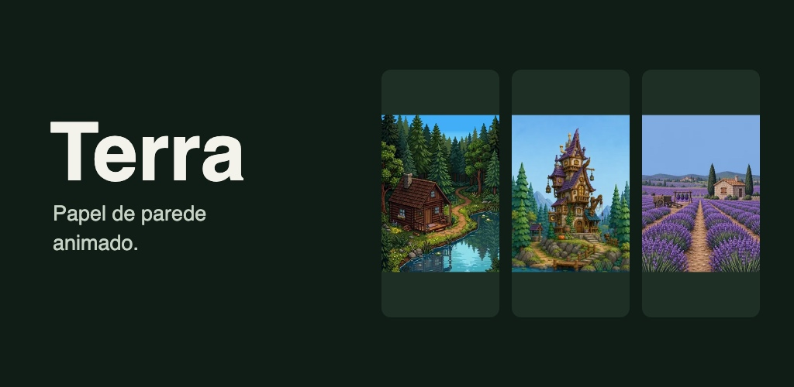

# Material da listagem — Terra / candidato 8

Pacote de 11/11/2026 aprovado editorial e visualmente em [88/6807363318](https://github.com/gabzieg/atmosfera/issues/88#issuecomment-6807363318), preparado na [#88](https://github.com/gabzieg/atmosfera/issues/88#issuecomment-6804730825).
Não publicada nem cadastrada no Console. Textos e acesso em inglês estão na [FICHA.md](FICHA.md).
App de origem: `e82a0c66e8a747b019fa67cac600b3738610eb8c` (1.0.5/código 8).

## Propostas atuais

| JPEG para revisão/cadastro futuro | Fonte SVG editável | Conteúdo |
|---|---|---|
| [Início](candidate-8-proposal/01-home.jpg) | [SVG](candidate-8-proposal/01-home.svg) | Localização negada, clima salvo e aviso de local padrão |
| [Loja](candidate-8-proposal/02-store.jpg) | [SVG](candidate-8-proposal/02-store.svg) | Catálogo e amostras grátis; bloqueios pagos visíveis |
| [Prévia](candidate-8-proposal/03-wallpaper-preview.jpg) | [SVG](candidate-8-proposal/03-wallpaper-preview.svg) | Casa da bruxa/Clay grátis, prévia dentro do app; não é captura do launcher |
| [Feature graphic](candidate-8-proposal/feature-graphic.jpg) | [SVG](candidate-8-proposal/feature-graphic.svg) | Terra com miniaturas Cabana/Pixel, Bruxa/Clay e Lavanda/Pixel |



Os três screenshots são JPEG RGB de **1080×2160**, razão 2:1, sem canal alfa.
O banner é JPEG RGB de **1024×500**, sem canal alfa. Medidos com Pillow em
11/11/2026; hashes, dimensões, fontes e método no [registro de proveniência](candidate-8-proposal/provenance.json).
Atendem aos limites de arquivo/dimensões consultados nas [regras oficiais da Play](https://support.google.com/googleplay/android-developer/answer/9866151?hl=en),
sem constituir garantia de aprovação pela loja. O aceite do dono não autoriza cadastro.

## Enquadramento e reprodução

Originais do ensaio `e82a0c6` preservados fora do Git: `01-negada-com-cache.png`,
`04-catalogo-gratis.png` e `05-wallpaper-aplicado.png`, todos 1080×2400 RGBA.
Cada SVG incorpora o PNG integral, escala ambos os eixos por 0,9 para 972×2160,
e acrescenta 54 px de margem em cada lateral. Nenhum corte, reconstrução ou
mudança na UI. A escala não revela conteúdo além do viewport original.
A imagem de início documenta uma condição real de teste, incluída no pacote aprovado;
o pacote não representa cobertura de todas as telas ou prova de compras.

O banner incorpora miniaturas exatas do catálogo desse commit, sem geração de arte.
Lavanda/Pixel é arte paga; o banner não promete que as três artes sejam gratuitas.
As miniaturas são encaixadas proporcionalmente, sem recorte. O SVG mantém suas fontes
incorporadas e o texto editável; a tipografia é Helvetica/Arial com fallback sans-serif.
Os JPEG entregues fixam a renderização inspecionada, independentemente da fonte instalada.

Exportação realizada com Chromium headless shell local, viewport igual ao SVG,
escala de dispositivo 1 e sem barras de rolagem. Exemplo (ajustar o executável local):

```bash
chrome-headless-shell --disable-gpu --hide-scrollbars --force-device-scale-factor=1 \
  --window-size=1080,2160 --screenshot=/caminho/01-home.png \
  file:///caminho/01-home.svg
sips -s format jpeg -s formatOptions 95 /caminho/01-home.png --out /caminho/01-home.jpg
```

Para o banner usar viewport 1024,500. SVG é fonte de revisão; não é formato de upload.
A tentativa com miniatura Quick Look produziu canvas quadrado e corte: foi descartada,
não redimensionada para disfarçar o corte. Os quatro JPEG finais foram abertos e
inspecionados. Essa conferência valida a composição exportada, não um novo ensaio do app.
Não houve recaptura, novo AVD, conta, compra, destrave de debug ou acesso ao Console.

## Histórico preservado

Os arquivos PNG da raiz desta pasta e o conteúdo abaixo são históricos de agosto,
não capturas do candidato 8. A feature antiga usa Atmosfera; não deve ser confundida
com a proposta Terra. O ícone existente não foi substituído nem revalidado nesta tarefa.
As instruções antigas de AVD/debug abaixo explicam a produção histórica; não são
roteiro atual de acesso do revisor. A redação anterior e as decisões do dono estão no
[histórico da ficha](history/listing-before-candidate-8.md).

---

# Ficha da Play Store — material gráfico

Capturas de tela para a listagem do Terra na Google Play (Fase 5 do
[ROADMAP.md](../dev/ROADMAP.md)). Feitas em 2026-08-25 no AVD `Pixel_8`
(API 36), com o app da branch `front/kotlin-2-billing-9`.

## O que está aqui

| Arquivo | Tela | Por que está na ficha |
|---|---|---|
| `01-onboarding.png` | Onboarding, passo 1 | Cena em tela cheia com a frase que explica o produto — é o gancho |
| `02-wallpaper-aplicado.png` | Launcher do Android | O produto rodando de verdade, atrás dos ícones |
| `03-inicio.png` | Início | Clima real ligado à cena, com "Meus cenários" |
| `04-loja.png` | Loja | Variedade: quatro cenários, artes diferentes, estados "Atual" e "Bloqueado" |
| `05-detalhe-cenario.png` | Detalhe (Fiordes) | Prévia ao vivo — prova que é motor, não imagem parada |
| `06-premium.png` | Venda do Premium | Comparador grátis × vivo, a proposta da compra |

Ajustes ficou de fora de propósito: mostra cuidado, mas não vende wallpaper.

## Especificação que elas cumprem

Verificado arquivo por arquivo, não assumido:

- **1080×1920**, razão 1,78 — o teto da Play é **2:1**. Captura crua do
  `Pixel_8` sai 1080×2400 (2,22:1) e **seria rejeitada**; por isso o emulador
  é forçado pra 1080×1920 antes de capturar.
- **PNG 24-bit, sem canal alfa** — `screencap` grava com alfa, que a Play não
  aceita; cada arquivo é redesenhado em `Format24bppRgb`.
- Lado mínimo ≥ 320 px e máximo ≤ 3840 px.

## Como refazer

```bash
adb shell wm size 1080x1920      # obrigatório: 1080x2400 estoura a razão 2:1
# … capturar com screencap -p …
adb shell wm size reset          # devolver o emulador ao estado original
```

Depois converter pra 24-bit sem alfa (o `screencap` sozinho não serve).

Duas capturas exigem preparo de estado:

- **02** — o wallpaper precisa estar aplicado, e o `screencap` **não** pega a
  superfície do live wallpaper nos primeiros segundos: a primeira tentativa
  sai preta. Espere o launcher desenhar e capture de novo.
- **05** — sem conta Google no emulador o Billing não responde e o botão fica
  "Indisponível", o que faz o app parecer quebrado numa ficha de loja. É
  artefato do ambiente de teste, não do produto: ligue **Destravar cenários
  pagos (teste)** no painel de debug antes de capturar, e desligue depois.

## Ícone da ficha — `icone-512.png`

512×512, PNG 32-bit, 9 KB, **zero pixel transparente** (a Play rejeita fundo
transparente na ficha: ela renderiza por cima um preto ou branco que você não
escolheu). Conferido pixel a pixel, não assumido.

O ícone do app é 100% vetorial (`res/mipmap-*/ic_launcher.xml` → cor sólida +
`drawable/ic_launcher_foreground.xml`), sem nenhum PNG no repo. Como o vetor são
seis formas geométricas simples e o primeiro plano já preenche os 108×108 com
azul opaco (a cor de fundo `colorPrimaryDark` fica coberta), ele foi
rasterizado diretamente das coordenadas do `pathData` — sem precisar mexer no
app. Conferido contra o ícone real na gaveta de apps do emulador: mesmas cores,
mesma montanha, mesma posição do sol.

O arquivo é a versão **sem máscara** (quadrado cheio), que é o correto: a Play
aplica o próprio arredondamento de 30%.

### ⚠️ Dois problemas com o ícone, que este arquivo só reproduz fielmente

1. **O sol é cortado pela máscara do launcher.** No aparelho ele aparece como um
   pedaço de amarelo grudado na borda. O `pathData` põe o sol em x 70–94 de 108,
   e a máscara adaptativa corta tudo fora da zona central (~x 18–90). É defeito
   do vetor, não da renderização — conteúdo de adaptive icon precisa caber na
   zona segura.
2. **É um ícone genérico de template.** Montanha e sol chapados não dizem nada
   sobre um app cuja proposta é cena pintada à mão com motor de partículas — e
   vai competir na Play ao lado de apps que usam a própria arte. Um recorte da
   cabana comunicaria o produto em vez de escondê-lo.

Nenhum dos dois bloqueia o upload; os dois custam conversão.

## Feature graphic — `feature-graphic-1024x500.png`

1024×500, PNG **24-bit sem canal alfa** (a Play não aceita alfa aqui), 371 KB.

Composição: fundo no mesmo `#0D1117` do app, três ladrilhos arredondados com
cabana, fiordes e tanque, e o bloco de texto no padrão que o próprio app usa
(kicker miúdo em maiúsculas → título → tagline). A ideia é que a peça pareça o
Atmosfera, não um banner genérico: quem vê a ficha e depois abre o app reconhece
o mesmo desenho.

Os três ladrilhos existem para comunicar **variedade** — o argumento de venda é
que há cenários diferentes, e uma imagem só não diz isso. A tagline "Chove lá
fora, chove na sua tela." ecoa de propósito a descrição curta da `FICHA.md`;
repetir a mesma promessa nos dois lugares é o que faz ela grudar.

Texto e ladrilhos ficam dentro de margem de 64 px porque **a Play corta as
bordas** em algumas telas.

## Ícone — `icone-512.png`

Recorte 384×384 da cabana ampliado 4/3 (escala regular: cada 3 pixels da fonte
viram 4, sem borrar o pixel art). 512×512, zero pixel transparente.

**Critério da escolha foi legibilidade, não fidelidade.** Duas alternativas
foram geradas e descartadas:

- *Recorte 512×512 em escala 1:1* — tecnicamente mais puro, zero reamostragem,
  mas a cabana ficava pequena demais no tamanho em que ícone é realmente visto.
- *Recorte 256×256 em 2×* — tão fechado que virou textura de madeira. Sem
  silhueta, irreconhecível.

O ícone anterior (montanha e sol vetoriais) também saiu: genérico, não dizia nada
sobre o produto, e tinha o sol fora da zona segura do adaptive icon — a máscara
do launcher cortava, e no aparelho aparecia um pedaço de amarelo grudado na
borda.

### O ícone do app foi trocado junto

`res/mipmap-*/ic_launcher.xml` agora aponta a camada de **fundo** para
`res/drawable-nodpi/cena_icone.png` (432 px = 108dp em xxxhdpi), e a camada de
**frente** virou um vetor transparente. Cena vai no fundo porque é lá que o
Android espera arte que sangra até a borda; a frente é a camada que os launchers
deslocam em parallax, e arte de cena ali ficaria descolada ao animar.

**A camada fica em `drawable`, não em `mipmap`** — e isso não é detalhe de
gosto. Na primeira tentativa ela foi parar em `mipmap-*/ic_launcher_bg.png`, e o
lint disparou 10 avisos novos (`IconLauncherShape`, `IconExpectedSize`,
`IconMissingDensityFolder`): ele tratou a *camada* como se fosse um ícone de
launcher inteiro, e reclamou que arte quadrada não tem silhueta. A convenção do
Android é que só o XML do adaptive icon mora em `mipmap`; as camadas moram em
`drawable`. Movido pra lá, os 10 avisos sumiram — corrigindo a causa, sem
precisar engordar o `lint-baseline.xml`.

**A composição do ícone do app não é a mesma da ficha, de propósito.** O adaptive
icon tem 108dp, mas só os 72dp centrais sobrevivem à máscara. Para o resultado
*mascarado* equivaler ao recorte aprovado de 384 px, a camada inteira precisa
cobrir `384 × 108/72 = 576` px da fonte. Conferido na gaveta de apps do
emulador: dentro do círculo aparece a cabana enquadrada como na ficha.
